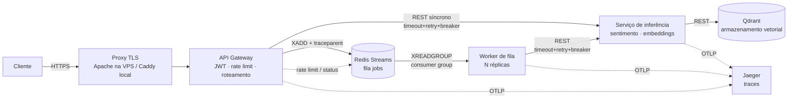

# Plataforma de IA como Serviço — C3.A2

**Sistemas Distribuídos e Computação em Nuvem · FAESA · 2026/2** · Prof. Howard Roatti

Plataforma cloud-native que expõe uma carga de trabalho de IA (análise de sentimento,
embeddings e busca semântica) como serviço. Ela é **conteinerizada, publicada na internet
com HTTPS, observável (rastreamento distribuído) e protegida (JWT, rate limit, LGPD)**.

> A IA é a *carga de trabalho*, não o objeto de estudo: o modelo é um scikit-learn
> simples, treinado no build da imagem. O foco é a engenharia distribuída.

## URL pública

| | |
|---|---|
| **API (HTTPS)** | **https://ia.SEUDOMINIO.com.br** ← *substituir pela URL real após o deploy* |
| Documentação interativa (Swagger) | `/docs` |
| Painel de métricas | `/painel` |
| Rastreamento (Jaeger, com senha) | `/jaeger` |
| Conta de demonstração | usuário `demo` · senha `demo123` |

Teste rápido do deploy público: `bash scripts/demo.sh https://ia.SEUDOMINIO.com.br`

---

## 1. Arquitetura



| Serviço | Tecnologia | Responsabilidade | Exposto? |
|---|---|---|---|
| **gateway** | FastAPI | Porta de entrada única: login/JWT, rate limit, roteamento síncrono (REST) e assíncrono (fila), métricas e painel | sim (via proxy TLS) |
| **inferencia** | FastAPI + scikit-learn | Classificação de sentimento, geração de embeddings, busca semântica. **Único** serviço que acessa o Qdrant | não |
| **worker** | Python | Consome a fila com consumer group, indexa documentos, retentativas, dead-letter queue e expurgo por retenção | não |
| **redis** | Redis 7 (AOF) | Mensageria (Redis Streams), status dos jobs (com TTL), contadores de rate limit | não |
| **qdrant** | Qdrant 1.12 | Armazenamento vetorial (texto + vetor + sentimento, com prazo de expiração) | não |
| **jaeger** | Jaeger all-in-one | Coleta (OTLP) e visualização dos traces distribuídos | só a UI, com senha |
| **https** | Caddy (apenas local) | Terminação TLS local em `https://localhost:8443` | sim |

Cada serviço tem o seu próprio `Dockerfile` ([gateway/](gateway/Dockerfile),
[inferencia/](inferencia/Dockerfile), [worker/](worker/Dockerfile)); Redis, Qdrant,
Jaeger e Caddy usam imagens oficiais. O código compartilhado (resiliência e
telemetria) fica em [comum/](comum/) e é copiado para cada imagem.

### Fluxos de comunicação

**Síncrono (REST):** `POST /predict` → gateway → inferência → resposta imediata.

**Assíncrono (mensageria):** `POST /documentos` → o gateway grava o job e publica
no stream `jobs` (responde `202 Accepted` com o `job_id`) → um worker consome →
chama a inferência (`/indexar`) → a inferência classifica, gera o embedding e grava no
Qdrant → o worker atualiza o status. O cliente acompanha em `GET /jobs/{id}` e
consulta os documentos com `POST /busca` (busca semântica).

**Descoberta de serviços:** os containers se encontram pelo nome (`http://inferencia:8001`,
`redis://redis:6379`) na rede interna do compose, nunca por IP.

### Endpoints do gateway

| Método | Rota | Auth | Descrição |
|---|---|---|---|
| GET | `/saude`, `/prontidao` | – | liveness / readiness (Redis + estado do breaker) |
| POST | `/login` | – | emite JWT (`{"usuario","senha"}`) |
| POST | `/predict` | JWT | sentimento síncrono |
| POST | `/documentos` | JWT | enfileira documento (202 + `job_id`) |
| GET | `/jobs/{id}` | JWT | status/resultado do job (só os próprios jobs) |
| POST | `/busca` | JWT | busca semântica nos próprios documentos (`{"texto","k"}`) |
| DELETE | `/documentos/{id}` | JWT | eliminação do dado a pedido do titular (LGPD) |
| GET | `/metricas`, `/painel` | – | métricas agregadas e painel (sem dados pessoais) |

---

## 2. Como executar do zero (um comando)

**Pré-requisitos:** Docker com Compose v2 **ou** Podman com `podman compose`. Nada mais
(nem Python, nem internet depois do build: o modelo é treinado dentro da imagem).

```bash
git clone https://github.com/nascimentodavi/plataforma-ia-como-servico-c3a2.git
cd plataforma-ia-como-servico-c3a2

docker compose up --build          # ou: podman compose up --build
```

O `.env` é opcional localmente: todas as variáveis têm padrão no `docker-compose.yml`
(veja [.env.example](.env.example)). Quando todos os serviços ficarem *healthy*:

| O quê | Onde |
|---|---|
| API | http://localhost:8000 (Swagger em `/docs`) |
| API via HTTPS local | https://localhost:8443 (certificado da CA interna do Caddy, aceite o aviso) |
| Painel de métricas | http://localhost:8000/painel |
| Traces (Jaeger) | http://localhost:16686 |

### Testando

Teste ponta a ponta automatizado (bash + curl):

```bash
bash scripts/demo.sh                     # local
```

Ou manualmente:

```bash
TOKEN=$(curl -s -X POST localhost:8000/login -H 'Content-Type: application/json' \
  -d '{"usuario":"demo","senha":"demo123"}' | sed -n 's/.*"access_token":"\([^"]*\)".*/\1/p')

curl -X POST localhost:8000/predict -H "Authorization: Bearer $TOKEN" \
  -H 'Content-Type: application/json' -d '{"texto":"servico excelente"}'

curl -X POST localhost:8000/documentos -H "Authorization: Bearer $TOKEN" \
  -H 'Content-Type: application/json' -d '{"texto":"o produto chegou quebrado"}'
# -> {"job_id":"...","status":"enfileirado"}   depois: GET /jobs/<job_id>

curl -X POST localhost:8000/busca -H "Authorization: Bearer $TOKEN" \
  -H 'Content-Type: application/json' -d '{"texto":"produto com defeito"}'
```

Testes unitários (resiliência, JWT, rate limit, fila): `pip install -r tests/requirements.txt && pytest tests`
(também rodam no CI).

---

## 3. Resiliência e tratamento de falhas

Implementada em [comum/resiliencia.py](comum/resiliencia.py) e aplicada a **toda**
chamada entre serviços (gateway→inferência, worker→inferência, inferência→Qdrant):

| Padrão | Como funciona | Configuração |
|---|---|---|
| **Tempo-limite** | toda chamada HTTP tem timeout de conexão (2 s) e de leitura; Redis com `socket_timeout` | `TIMEOUT_INFERENCIA_S=5` |
| **Retentativa com espera progressiva** | só para falhas transitórias (timeout, conexão, 5xx, 429); espera exponencial com *jitter* (0,2 s → 0,4 s → ...); erros 4xx **não** são repetidos | `TENTATIVAS=3` |
| **Circuit breaker** | FECHADO → (N falhas seguidas) → ABERTO: falha imediata com `503` + `Retry-After`, sem gastar recurso no serviço doente → após `CB_TEMPO_RESET_S` vira MEIO-ABERTO e deixa 1 chamada de teste passar | `CB_LIMITE_FALHAS=5`, `CB_TEMPO_RESET_S=30` |
| **Fila at-least-once** | worker só faz `XACK` depois de processar; mensagem sem ACK é recuperada por outra réplica (`XAUTOCLAIM`) após `VISIBILIDADE_MS`; indexação idempotente (id do ponto = `job_id`) | `VISIBILIDADE_MS=15000` |
| **Dead-letter queue** | após `MAX_TENTATIVAS` a mensagem vai para `jobs:dlq` e o job fica `falhou` (não bloqueia a fila) | `MAX_TENTATIVAS=5` |
| **Degradação controlada** | Redis fora → rate limit *falha aberto* (registra aviso); fila fora → `503` claro para o cliente | – |
| **Healthchecks + restart** | todos os serviços têm healthcheck; `depends_on: service_healthy`; `restart` automático | – |

### Demonstrando

```bash
# 1) Derrubar a inferência: 2 requisições fazem 3 tentativas cada; o breaker ABRE
#    e as seguintes falham em ~10 ms com 503 + Retry-After.
docker compose stop inferencia
bash scripts/demo.sh            # falha no passo 4 com 503
curl localhost:8000/metricas    # "estado":"aberto"
docker compose start inferencia # ~30 s depois o breaker testa e FECHA sozinho

# 2) Injeção de falhas: 50% de erro 500 na inferência -> veja as retentativas nos logs/Jaeger
FALHA_PERCENTUAL=50 docker compose up -d inferencia

# 3) Lentidão: 8 s de atraso > timeout de 5 s -> tempo-limite + retentativa + breaker
LATENCIA_EXTRA_MS=8000 docker compose up -d inferencia

# 4) Fila durável: com a inferência parada, POST /documentos continua aceitando (202)
#    e os jobs ficam "aguardando_retentativa". Se ela voltar antes de esgotar
#    MAX_TENTATIVAS (~75 s com os padrões), o worker processa o acumulado; senão,
#    os jobs vão para a dead-letter queue (status "falhou"). Escala horizontal:
docker compose up -d --scale worker=3
```

---

## 4. Observabilidade

- **Rastreamento distribuído (OpenTelemetry → Jaeger)** ([comum/telemetria.py](comum/telemetria.py)):
  FastAPI, `requests` e Redis são instrumentados; o contexto W3C (`traceparent`) viaja
  nos cabeçalhos HTTP e, **na fila, dentro da própria mensagem** (o gateway injeta no
  `XADD`, o worker extrai antes de processar). Resultado: **um único trace** com
  `gateway (POST /documentos) → jobs publish → jobs process (worker) → inferencia
  (/indexar → modelo.classificar → modelo.embedding) → PUT no Qdrant`, incluindo
  o tempo de espera na fila (`fila.tempo_espera_s`) e o número da tentativa.
  Abra o Jaeger, escolha o serviço `gateway` e a operação `POST /documentos`.
- **Logs estruturados em JSON** com `trace_id` (correlação log ↔ trace). Registram
  apenas método, rota, status e duração. Nunca registram corpo, query string, IP ou token.
- **Métricas** em `/metricas` e painel em `/painel`: estado do circuit breaker, tamanho
  da fila, pendentes sem ACK, DLQ, jobs processados/falhos/retentados, workers ativos.
- Um *sampler* descarta traces que começam em spans de cliente (ex.: o `XREADGROUP`
  que o worker faz a cada 5 s), para que o Jaeger mostre só fluxos de negócio.

---

## 5. Segurança

| Controle | Implementação |
|---|---|
| **HTTPS** | Produção: Apache + certificado Let's Encrypt (renovação automática) com redirecionamento HTTP→HTTPS e HSTS. Local: Caddy com CA interna |
| **Autenticação JWT** | `POST /login` emite token HS256 com `exp` (30 min), `iss` e `sub`; todas as rotas de negócio exigem `Authorization: Bearer` (401 se ausente, inválido, forjado ou expirado) |
| **Rate limit** | janela fixa por minuto no Redis (compartilhada entre réplicas): 30 req/min por usuário, 10 tentativas de login/min por IP (contra força bruta) → `429` + `Retry-After` |
| **Superfície mínima** | só o proxy TLS é público; gateway e Jaeger escutam em `127.0.0.1` na VPS; inferência, worker, Redis e Qdrant ficam só na rede interna |
| **Autenticação serviço a serviço** | inferência exige `X-Token-Interno`; Qdrant exige `api-key` |
| **Isolamento entre usuários** | cada documento é gravado com o pseudônimo do dono; jobs, busca e exclusão filtram por ele |
| **Segredos** | 100% em variáveis de ambiente (`.env` fora do Git); em produção a stack **não sobe** sem eles (`${VAR:?}`) |
| **Containers** | imagens `slim`, processos como usuário não-root (uid 10001) |
| **Validação de entrada** | Pydantic (tamanhos máximos, formatos) em todas as rotas |

---

## 6. Conformidade com a LGPD

**Controlador/finalidade:** projeto acadêmico de demonstração. Os dados são tratados
**exclusivamente para prestar o serviço solicitado pelo próprio usuário** (classificar
o texto, indexá-lo e permitir a busca semântica), com base na execução do serviço
pedido pelo titular (art. 7º, V). Não há compartilhamento com terceiros, uso para
treinar modelos, perfilamento nem publicidade. O modelo roda localmente e nenhum
texto é enviado a APIs externas.

| Dado | Onde fica | Finalidade | Retenção |
|---|---|---|---|
| Usuário e senha (contas de demonstração) | variável de ambiente `USUARIOS` | autenticação | enquanto a conta existir |
| Token JWT | **não é armazenado** no servidor | autorização das requisições | expira em 30 min |
| Texto enviado em `/predict` | só em memória durante a requisição | classificar sentimento | **não é armazenado** |
| Texto enviado em `/documentos` (na fila) | Redis Stream | entregar ao worker | até o processamento (segundos): é apagado da fila (`XDEL`) logo após o ACK. Na DLQ fica só o `job_id` e o motivo, o texto é descartado |
| Texto + vetor + sentimento do documento | Qdrant | busca semântica pelo próprio usuário | **7 dias** (`RETENCAO_VETORES_S`); o worker expurga os vencidos a cada hora, e a busca já ignora expirados |
| Status/resultado do job | Redis (hash com TTL) | o usuário acompanhar o processamento | **24 h** (`RETENCAO_JOB_S`, TTL do Redis) |
| Identificador do usuário nos dados | Redis/Qdrant guardam só um **pseudônimo** (HMAC-SHA256 com segredo) | isolar os dados de cada usuário | mesma retenção do dado ao qual está ligado |
| IP / usuário no rate limit | Redis, apenas o **pseudônimo HMAC** | proteção contra abuso/força bruta | **60 s** |
| Logs da aplicação | stdout dos containers | operação e diagnóstico | **não contêm dados pessoais** (só método, rota, status, duração e `trace_id`) |
| Traces | Jaeger (em memória) | diagnóstico de desempenho/falhas | **não contêm o texto** (argumentos do Redis mascarados, sem query string); descartados ao reiniciar o Jaeger |
| Log de acesso do Apache | `/var/log/apache2` da VPS | operação do proxy | formato próprio **sem IP e sem query string**; rotação do Ubuntu (14 dias). O log de erros do Apache pode conter IP, com a mesma rotação |

**Direitos do titular (art. 18):** eliminação imediata via `DELETE /documentos/{id}`
(remove vetor, texto e status do job); acesso aos próprios dados via `GET /jobs/{id}` e
`POST /busca`. **Minimização:** só o necessário é guardado, pelo menor tempo possível.
**Segurança (art. 46):** HTTPS, JWT, segredos fora do código, serviços internos não expostos.

---

## 7. Relatório de trade-offs

### CAP

Em uma partição de rede, um sistema distribuído escolhe entre **consistência (C)** e
**disponibilidade (A)**. Esta plataforma escolhe **disponibilidade** no caminho de
escrita e aceita **consistência eventual**:

- **Ingestão assíncrona (AP):** `POST /documentos` responde `202` assim que a mensagem
  está na fila, mesmo com a inferência ou o Qdrant fora. O documento só fica
  pesquisável quando o worker processar. Uma busca logo após o envio pode não
  encontrá-lo (*read-your-writes* não é garantido). Em troca, a ingestão continua
  funcionando com partes do sistema caídas.
- **Entrega pelo menos uma vez:** preferimos processar duas vezes a perder mensagem.
  A duplicata é inofensiva porque a indexação é **idempotente** (`job_id` = id do ponto).
- **Rate limit falha aberto:** sem Redis, o limite deixa de ser aplicado (A) em vez de
  bloquear todos os usuários (C). É um risco aceito para um contador de proteção.
- **Circuit breaker por processo:** cada réplica tem o seu estado (sem coordenação).
  Réplicas podem discordar por alguns segundos, mas não há ponto único de falha
  nem latência extra para sincronizar.
- **Onde há C:** o Redis e o Qdrant são instâncias únicas (CP local, sem réplicas),
  então dentro de cada um a leitura é consistente. O preço é que eles são pontos
  únicos de falha. Mitigação: AOF no Redis, volume persistente no Qdrant, `restart`
  automático. Em escala seriam Redis Sentinel/Cluster e Qdrant distribuído.

### Custo

| Opção | Custo | Observação |
|---|---|---|
| **Adotada: VPS própria, todos os containers em um host** | custo fixo da VPS já existente (marginal ≈ R$ 0) | ~1,2 GB de RAM; Let's Encrypt gratuito; sem cobrança por requisição |
| PaaS free tier (Render/Railway) | R$ 0 | serviços "dormem" (cold start de 30–60 s), sem worker gratuito, Redis/Qdrant limitados |
| Kubernetes gerenciado | alto (control plane + nós + LB) | só compensa com muitas réplicas; manifests prontos em [k8s/](k8s/) |
| LLM via API paga | por token | evitado: o modelo local custa zero por requisição e não envia dados a terceiros (melhor para a LGPD) |

Escolhas que economizam: **Redis faz três papéis** (fila, cache de status e rate limit)
em vez de RabbitMQ + banco separados; o modelo é treinado no build (sem GPU); o
Jaeger guarda traces em memória; o worker escala horizontalmente só quando a fila cresce.

### Latência

| Caminho | Latência típica (medida localmente) | Por quê |
|---|---|---|
| `POST /predict` (síncrono) | ~15–30 ms | 1 salto gateway→inferência; modelo leve em memória |
| `POST /documentos` (resposta) | ~10–20 ms | só grava no Redis e responde `202` |
| Processamento do job no worker | ~15–35 ms | classificação + embedding + escrita no Qdrant (`wait=true`) |
| Documento pesquisável (fim a fim) | < 100 ms com a fila vazia | resposta + espera na fila + processamento |
| Breaker aberto | ~10 ms | *fail fast*: não espera timeout |
| Inferência fora, breaker fechado | até ~0,6 s | 3 tentativas com backoff antes do 503 |

- **Assíncrono vs síncrono:** a fila tira o trabalho pesado do caminho da requisição
  (latência percebida baixa e previsível), ao custo de consistência eventual e de
  mais componentes.
- **Timeout × retentativas × backoff:** o pior caso de uma chamada é
  `tentativas × timeout + esperas` (≈ 3 × 5 s + 0,6 s). Valores maiores aumentam a
  chance de sucesso, mas também a latência de cauda. O breaker limita esse custo
  quando a falha é persistente.
- **Gateway + proxy TLS** acrescentam ~1–2 ms por salto, um preço baixo pela
  centralização de autenticação, limite e TLS.
- **Rastreamento:** exportação em lote (`BatchSpanProcessor`), fora do caminho crítico.

---

## 8. Deploy na nuvem (VPS própria)

A stack roda numa VPS Ubuntu com **Podman**, atrás do **Apache** (que já atendia
80/443) fazendo o TLS com Let's Encrypt. O mesmo `docker-compose.yml` é usado, mais a
sobreposição [docker-compose.prod.yml](docker-compose.prod.yml) (portas só em
`127.0.0.1`, segredos obrigatórios, `restart: always`):

```bash
podman compose -f docker-compose.yml -f docker-compose.prod.yml up -d --build
```

Passo a passo completo (DNS, Podman, segredos, Apache, certbot, CD):
**[deploy/INSTRUCOES-VPS.md](deploy/INSTRUCOES-VPS.md)**.

---

## 9. Extensões opcionais implementadas

- **CI/CD** ([.github/workflows/ci-cd.yml](.github/workflows/ci-cd.yml)): testes unitários → sobe a
  stack inteira no runner e roda o teste ponta a ponta → (opcional) publica na VPS via SSH a cada push na `main`.
- **Painel de métricas**: `/painel`.
- **Manifests de Kubernetes** ([k8s/](k8s/)): Deployments/StatefulSets, probes, Ingress com TLS, HPA.
- **Autoescalonamento por tamanho da fila**: `ScaledObject` do KEDA no worker
  (1 réplica a cada 20 mensagens pendentes, até 10). No compose: `--scale worker=N`.

## 10. Estrutura do repositório

```
├── gateway/            API Gateway (app.py, seguranca.py, painel.html, Dockerfile)
├── inferencia/         serviço de inferência (app.py, modelo.py, vetores.py, Dockerfile)
├── worker/             worker de fila (worker.py, Dockerfile)
├── comum/              resiliência + telemetria compartilhadas
├── tests/              testes unitários (pytest)
├── scripts/demo.sh     teste ponta a ponta
├── deploy/             guia da VPS, vhost do Apache, Caddyfile local, script de atualização
├── k8s/                manifests de Kubernetes (opcional)
├── docker-compose.yml       sistema inteiro com um comando
└── docker-compose.prod.yml  sobreposição de produção
```

Baseado no [kit de partida](https://github.com/howardroatti/sd-2026-2-kit-c3a2) da disciplina.
